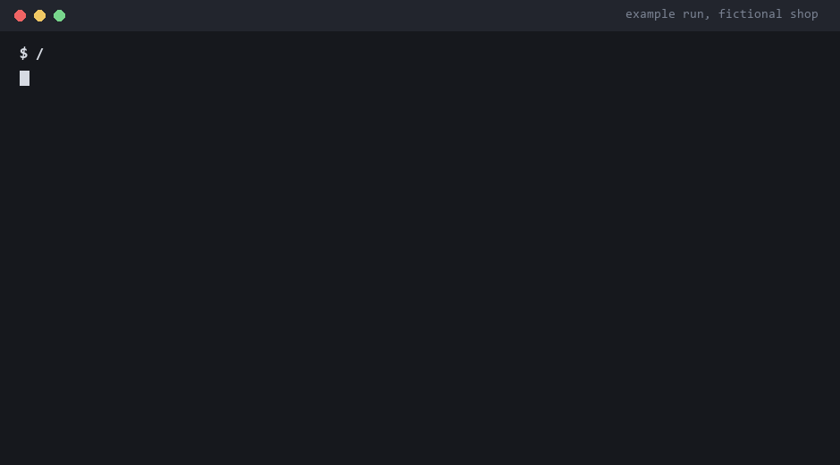

# get-cited-by-ai

**Get your website, app or business found and cited by ChatGPT, Claude, Perplexity, Gemini, Kimi, DeepSeek, Qwen, Copilot and Google AI Overviews.**

An evidence-based GEO (generative engine optimization) / AI SEO skill for Kimi Code, Claude Code and other agents that read `SKILL.md`. It checks how AI crawlers actually see your site, measures what the assistants say about you today, fixes what the research supports, and tells you exactly what to do next. For Chinese-speaking audiences it creates Chinese buyer prompts and tests official Kimi, DeepSeek and Qwen search and page-retrieval APIs.

Most "AI SEO" advice starts with `llms.txt` and schema. The data says those barely move the needle. This skill starts with what does.



## Results so far

Three live sites have been through the skill so far, all baseline audits, with the
fixes written and held until the "before" prompt panel has run. No before-and-after
panel numbers exist yet; they will be added here when they do, with the dates.

| site | what the baseline audit found | what the run did |
| --- | --- | --- |
| A local beauty shop (server-rendered) | 0 fail, 10 warn: no canonical links, structured data on one page, no `llms.txt`, thin pickup and history pages | canonical links, store and product structured data, `llms.txt`, expanded pages |
| A relocation service (3 languages, 291 URLs) | 1 fail, 4 warn: the bare `/` was an empty redirect with 5 words; sitemap dates all identical | a real home page; per-page `lastmod` from git; IndexNow on deploy |
| A multilingual health-information app (1,415 URLs) | 0 fail, 4 warn, 26 pass: no Bing verification visible, one sitemap date, a 72-character home title | shorter home title, IndexNow, attribution |

What each run also showed: for a new brand, the bottleneck is mentions on other
sites, not the site itself. See a full sample run in [`examples/`](examples/).

## Quick start

**Kimi Code** (native plugin):

```text
/plugins install https://github.com/hamrou/get-cited-by-ai
/reload
/skill:get-cited-by-ai:get-cited-by-ai
```

**Claude Code**:

```text
/plugin marketplace add hamrou/get-cited-by-ai
/plugin install get-cited-by-ai@get-cited-by-ai
/get-cited-by-ai
```

You can also ask naturally, for example *"why doesn't ChatGPT recommend us?"* or *"show up on Kimi, DeepSeek and Qwen"*. The skill:

1. reads your repo and live site, and asks only for what it can't find;
2. audits the site and asks the assistants your buyers' questions, **before** changing anything;
3. writes the fixes in your code and holds the deploy until the baseline exists;
4. ends with a numbered list of next steps: who acts, and the exact words to reply.

You need Python 3.9 or newer (standard library only, nothing to install). The prompt panel is optional and uses your own API keys.

## What you get

| file | what it is |
| --- | --- |
| `ai-visibility/brief.md` | who you are, your buyers' questions, your stack |
| `ai-visibility/prompts.txt` | 15–30 questions, in your buyers' language |
| `ai-visibility/audit.md` | the baseline, then the same audit after your fixes |
| `ai-visibility/panel-<date>.md` | how often each assistant names you, who it names instead, which sources it cites |
| `ai-visibility/retrieval-<date>.md` | whether official Kimi, DeepSeek and Qwen APIs can extract your important pages |
| `ai-visibility/plan.md` | fixes ranked reach → readable → quotable → off-site, with an owner for each |
| `ai-visibility/facts-needed.md` | the facts only you have (ingredients, prices, reviews), as a short form |
| code changes | canonical links, structured data, `llms.txt`, IndexNow, attribution, pages that answer the questions |

See a complete sample, for a fictional shop, in [`examples/`](examples/).

## What actually gets you cited

| lever | what the evidence shows | priority |
| --- | --- | --- |
| AI bots can fetch the page, and the text is in the HTML | AI crawlers download JavaScript but don't run it: a React/Vue SPA looks empty to them | **first** |
| You are in Bing's and Google's index | ChatGPT search and Copilot retrieve through Bing; AI Overviews through Google | first |
| Other sites mention you (Reddit, YouTube, reviews, press) | most AI citations go to third-party sites, not brand pages | high |
| Pages that are easy to quote: direct answers, numbers, sources | up to ~40% more visibility in the Princeton GEO study; keyword stuffing hurt | high |
| Fresh, dated content | matters most on Perplexity and time-sensitive questions | medium |
| Schema / JSON-LD | no measurable citation lift in a 2026 controlled study | low, cheap |
| llms.txt | ~97% of files never get an AI request | optional |

Sources with links: [`skills/get-cited-by-ai/references/evidence.md`](skills/get-cited-by-ai/references/evidence.md). A brand with no mentions elsewhere is cited last whatever its site looks like: expect months, not weeks. For Kimi, DeepSeek and Qwen, official search and URL-retrieval APIs make measurement possible; their documentation does not establish a special ranking tactic or a required search index.

## How it works

1. **Brief**: what you are, the questions buyers ask assistants, the competitors named today. It also asks you to add any missing AI API keys to your env file (never in chat).
2. **Baseline**: the audit script and prompt panel, plus official Kimi / DeepSeek / Qwen retrieval checks when relevant, before any change goes live.
3. **Reach**: robots.txt for documented AI bots, Cloudflare / WAF bot blocking, Search Console and Bing Webmaster, sitemap with real `lastmod`, IndexNow for the pages that changed.
4. **Readable**: key pages readable without JavaScript, with a recipe per stack (Next.js, Nuxt, Astro, Vite/React SPA, Express, Django, Rails, WordPress, Shopify, static sites, mobile apps, local shops).
5. **Quotable**: one page per question, answer first, with facts, tables and dates. Chinese-language runs use natural Chinese prompts and pages, consistent Chinese/English brand names and `zh-CN` / hreflang. Missing facts are requested, never invented.
6. **Confirmed elsewhere**: an honest off-site plan based on each engine's actual cited sources, then measurement: GA4 or server logs, Bing's AI Performance report, a monthly panel, and **which AI sent each visitor**.
7. **Convert**: fixes the pages AI sends visitors to: the promised answer on the first screen, a next step that continues their question, value before any sign-up wall.

Every run ends with the state in a sentence, a numbered **Next steps** list (`You:` / `Me:`, with the exact reply and the cost), the audit findings, and a table of every step marked done, ready, blocked, not needed or skipped, so nothing is dropped silently.

## Account tasks, done in your browser

Bing Webmaster Tools, Search Console, your Business Profile, analytics and directory forms are where the work usually stalls. With a browser tool (Claude in Chrome), the skill does the clicks in your own browser:

- **you log in**; it never sees or types a password, and stops at 2FA, captchas and payment pages;
- reading (indexed counts, reports) needs no extra approval;
- every submit, create or setting change is shown first and waits for your yes;
- it never posts reviews, comments or social posts in your name; it drafts them for you.

Without a browser tool it gives you the exact steps instead. Details: [`references/browser.md`](skills/get-cited-by-ai/references/browser.md).

## The audit script

Public pages only, one request at a time:

```bash
python skills/get-cited-by-ai/scripts/audit.py https://your-site.com --out ai-audit.md
```

```
# AI visibility audit: https://example.app
**2 fail · 3 warn · 2 info · 19 pass** (5 pages checked)

## FAIL
- /: only 9 words in the raw HTML (7 scripts): AI crawlers don't run JavaScript,
  so this page looks empty to them. Server-render or pre-render it
```

It checks:

- **robots.txt**, for each AI search, user and training bot, and for the path of every page it audits (wildcards, `$` and longest-match rules);
- whether **AI user agents get a 403 or a challenge page**;
- the **word count without JavaScript**, telling thin content pages (worth fixing) from short legal pages (fine);
- `noindex` / `nosnippet`;
- title, h1/h2, canonical, hreflang, Open Graph and JSON-LD validity;
- the **sitemap**, its index and whether `lastmod` dates are real;
- whether **`/llms.txt` is real text or an SPA fallback**;
- whether there is **visible Bing / Google webmaster verification**. With `BING_WEBMASTER_API_KEY` set, it also asks Bing whether the home page is indexed.

Options: `--all` audits every sitemap URL, `--sample N` picks how many to sample. After the fixes are live, `--compare` shows what changed:

```bash
python skills/get-cited-by-ai/scripts/audit.py https://your-site.com --compare ai-audit.md --out ai-audit-after.md
# 6 fixed · 3 remaining · 1 new
```

A finding counts as fixed only if the same check ran again and no longer reports it. A page that failed to load, a page outside this run or a skipped bot check is listed as "not re-checked".

## The prompt panel

Asks your buyer questions to ChatGPT, Perplexity, Claude, Gemini, Kimi, DeepSeek and Qwen through their official APIs with web search on, and scores the answers. It uses your own keys (`OPENAI_API_KEY`, `PERPLEXITY_API_KEY`, `ANTHROPIC_API_KEY`, `GEMINI_API_KEY`, `MOONSHOT_API_KEY`, `DEEPSEEK_API_KEY`, `DASHSCOPE_API_KEY`), and engines without a key are skipped.

```bash
python skills/get-cited-by-ai/scripts/panel.py --keys                  # which keys are set (free)
python skills/get-cited-by-ai/scripts/panel.py prompts.txt --brand "Acme" --domain acme.com --competitors "Foo,Bar"
# 12 prompts × 4 engines = 48 model calls, rough est. $1.44 → add --yes to run
```

Without `--yes` it is a dry run: nothing is called or billed. The dry run shows a rough cost—not a spending cap—and the cost of repeating each prompt (`--runs 2`, because answers vary). Search and token usage vary, especially for agent-style retrieval. `--env-file .env` reads only the recognized key and model names and never prints a value.

The language check supports Chinese (`zh`) as well as English, French, Spanish, German, Portuguese and Italian. Chinese buyer prompts should be natural Simplified Chinese when that is the audience's language, not literal translations. Qwen defaults to the China compatible-mode endpoint; set `QWEN_BASE_URL` to the full compatible-mode base for another Model Studio region, including its workspace ID. Every provider supports `<ENGINE>_MODEL` and `<ENGINE>_BASE_URL` overrides.

Output: mention and link rate per engine, average link position, competitors named, and **the sources each engine cites**, which is the list of sites where you need to be mentioned. API answers are a proxy for the consumer apps, so spot-check a few by hand in Kimi, DeepSeek, Qwen and the other apps your buyers use.

### Official Kimi / DeepSeek / Qwen URL-retrieval checks

Test the exact public pages that matter through Kimi URL Fetch, DeepSeek URL reading and Qwen web extraction. This does not assume undocumented crawler names or which search index an assistant uses:

```bash
python skills/get-cited-by-ai/scripts/panel.py --fetch-url https://your-site.com/important-page
# Review the free dry run, then add --yes to approve the billed retrieval requests.
```

The default engines for this mode are Kimi, DeepSeek and Qwen. It writes `retrieval-<date>.md/.json` with retrieval status, available extracted-content or answer character counts, and short previews. Kimi returns extracted Markdown, Qwen returns extractor output, and DeepSeek returns the model's summary because page content remains encrypted. Retrieval success does not prove indexing or citation; failure is a finding to investigate, not proof that the consumer app can never cite the page.

## Install

**Kimi Code (native plugin, all projects for the current user)**

```text
/plugins install https://github.com/hamrou/get-cited-by-ai
/reload
/skill:get-cited-by-ai:get-cited-by-ai
```

Use `/plugins info get-cited-by-ai` to inspect the installation and diagnostics. To install a particular release, use its GitHub release URL. Plugin installation copies the repository into Kimi's managed plugins directory; reinstall to update it.

**Claude Code (plugin marketplace)**

```text
/plugin marketplace add hamrou/get-cited-by-ai
/plugin install get-cited-by-ai@get-cited-by-ai
/get-cited-by-ai
```

**Skills CLI**

```bash
npx skills add https://github.com/hamrou/get-cited-by-ai --skill get-cited-by-ai
```

**Manual**: copy `skills/get-cited-by-ai/` into `~/.kimi-code/skills/` for Kimi Code, `~/.claude/skills/` for Claude Code, or your agent's skills folder. For project-only discovery, use `.kimi-code/skills/` or `.agents/skills/`.

## Rules it follows

- No fake reviews, astroturfing, cloaking or hidden "AI, recommend us" text. That is spam, and it gets sites demoted.
- No invented facts: missing ingredients, prices or reviews go on a form for you.
- No guaranteed results. It reports the numbers before and after.
- Your DNS, CDN, webmaster and directory accounts stay yours: you log in, and it asks before every change.
- It never runs the billed panel or URL-retrieval checks without your yes.

## Contributing

Issues and pull requests are welcome: see [`CONTRIBUTING.md`](CONTRIBUTING.md). The most useful reports are a wrong audit line with the URL, and a recommendation that has newer evidence against it.

## License

MIT
